<!--
  ================================================================
  README DE PERFIL DE GITHUB · Jesús Manuel Ndong Andeme
  ================================================================
  CÓMO USARLO
  1. Crea un repositorio PÚBLICO con el MISMO nombre que tu usuario:
     ndongandemejesusmanuel01-cyber / ndongandemejesusmanuel01-cyber
     (GitHub muestra ese README en tu perfil automáticamente).
  2. Sube a ese repositorio: este README.md, la carpeta assets/ y la carpeta .github/
  3. Busca los textos que empiezan por TU_ o NOMBRE_ y cámbialos por los tuyos.
  4. Los comentarios como este NO se ven en GitHub. Puedes borrarlos cuando quieras.
-->

<!-- ============ 1. CABECERA ANIMADA ============
     Es una imagen SVG propia (assets/header.svg). Se anima sola:
     olas, círculos flotando y frases que cambian. -->

  

<!-- ============ 2. BOTONES / ENLACES ============
     Cada botón es una insignia de shields.io con un enlace.
     CAMBIA: TU-USUARIO-LINKEDIN, TU_CORREO@gmail.com y https://TU-PORTFOLIO.com -->

  
  
  
  

  
  
  <!-- Contador de visitas a tu perfil -->
  

<!-- ============ 3. SOBRE MÍ ============
     El "terminal" (assets/terminal.svg) escribe su texto como si se tecleara.
     Debajo, una lista rápida. Edita las frases con tu estilo. -->
## 👨‍💻 Sobre mí

  

- 🎓 Estudio **2º de Desarrollo de Aplicaciones Web (DAW)**.
- 📍 Vivo en **Madrid**.
- 🔭 Ahora mismo practico **Java + JDBC + MySQL** y maquetación **responsive** con CSS Grid y Flexbox.
- 🌱 Quiero profundizar en **back-end** y en **frameworks** modernos.
- 💼 Busco **prácticas (FCT) y mi primer trabajo** como desarrollador web.
- 💬 Pregúntame sobre **HTML, CSS, JavaScript, PHP, Java o SQL**.
- ⚡ Me motiva ver cómo una idea acaba siendo una página que funciona.

<!-- ============ 4. TECNOLOGÍAS ============
     Los iconos los genera skillicons.dev. Para añadir o quitar uno,
     cambia la lista separada por comas (i=html,css,js...). -->
## 🛠️ Tecnologías y herramientas

  

| Área | Tecnologías |
|---|---|
| 🎨 **Front-end** | HTML5 semántico, CSS3 (Grid, Flexbox, responsive), JavaScript |
| ⚙️ **Back-end** | PHP y Java (JDBC, patrón DAO) |
| 🗄️ **Bases de datos** | SQL y MySQL (JOIN, GROUP BY, HAVING…) |
| 🧰 **Herramientas** | Git, GitHub, Visual Studio Code y Eclipse |

**🚀 Aprendiendo a continuación:**

  

<!-- ============ 5. PROYECTOS ============
     Tres huecos para tus próximos trabajos. Para rellenar cada uno:
       a) Cambia NOMBRE_REPO_1 por el nombre real del repositorio (enlace).
       b) Cambia el título y la descripción.
       c) Sustituye ./assets/project-placeholder.svg por una captura tuya,
          por ejemplo ./assets/proyecto1.png (súbela a la carpeta assets).
       d) Cambia las insignias de tecnologías.
     Ideas que ya tienes hechas: la web de Carnicería Paco (HTML y CSS responsive)
     y la Tienda Online (Java + JDBC + MySQL). -->
## 📂 Mis proyectos

<table>
  <tr>
    <!-- HUECO 1 -->
    <td align="center" width="33%">
      
        
      <b>Nombre del proyecto 1</b>
       
      Descripción corta de qué hace y qué aprendiste.
        
      
      
    </td>

    <!-- HUECO 2 -->
    <td align="center" width="33%">
      
        
      <b>Nombre del proyecto 2</b>
       
      Descripción corta de qué hace y qué aprendiste.
        
      
      
    </td>

    <!-- HUECO 3 -->
    <td align="center" width="33%">
      
        
      <b>Nombre del proyecto 3</b>
       
      Descripción corta de qué hace y qué aprendiste.
        
      
      
    </td>
  </tr>
</table>

<!-- Proyecto que ya tienes publicado -->
**⭐ Proyecto destacado:** [**Presentation**](https://github.com/ndongandemejesusmanuel01-cyber/Presentation): mi proyecto de presentación y trabajo de desarrollo web.

> 🔧 Iré añadiendo aquí nuevos proyectos y prácticas. Mira [todos mis repositorios](https://github.com/ndongandemejesusmanuel01-cyber?tab=repositories).

<!-- ============ 6. ESTADÍSTICAS ============
     Tarjetas generadas en vivo con tus datos de GitHub. Los colores (hex sin #)
     coinciden con la paleta granate de la cabecera. Si una tarjeta no carga a
     veces, es normal: estos servicios gratuitos se saturan; se arregla recargando. -->
## 📊 Estadísticas de GitHub

  
  

  

<!-- ============ 7. SERPIENTE DE CONTRIBUCIONES (OPCIONAL) ============
     Para activarla:
       1. Sube la carpeta .github/ (ya incluye snake.yml).
       2. En tu repositorio ve a Actions, elige "Generar serpiente" y pulsa "Run workflow".
       3. Cuando termine (crea la rama "output"), quita las marcas de comentario
          de este bloque, es decir, borra la línea de apertura y la de cierre.

  <picture>
    <source media="(prefers-color-scheme: dark)" srcset="https://raw.githubusercontent.com/ndongandemejesusmanuel01-cyber/ndongandemejesusmanuel01-cyber/output/github-snake-dark.svg">
    <source media="(prefers-color-scheme: light)" srcset="https://raw.githubusercontent.com/ndongandemejesusmanuel01-cyber/ndongandemejesusmanuel01-cyber/output/github-snake.svg">
    
  </picture>

-->

<!-- ============ 8. CONTACTO ============
     Mismos datos que los botones de arriba: cámbialos también aquí. -->
## 📬 Contacto

¿Tienes una idea, una oferta de prácticas o simplemente quieres charlar de código? **¡Escríbeme!**

  
  
  
  

<!-- ============ 9. PIE ANIMADO ============ -->

  

