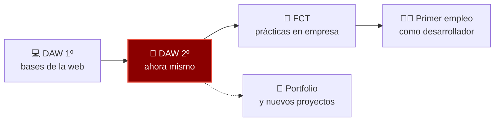

<!--
  ================================================================
  README DE PERFIL DE GITHUB · Jesús Manuel Ndong Andeme
  Estilo "programador": terminal, editor de código y consola.
  ================================================================
  CÓMO USARLO
  1. Crea un repositorio PÚBLICO con el MISMO nombre que tu usuario:
     ndongandemejesusmanuel01-cyber / ndongandemejesusmanuel01-cyber
  2. Sube a la RAÍZ de ese repositorio: README.md, la carpeta assets/ y la carpeta .github/
  3. Busca los textos que empiezan por TU_ o NOMBRE_ y cámbialos por los tuyos.
  4. Los comentarios como este NO se ven en GitHub. Puedes borrarlos.

  Si ves la página "en blanco" o sin imágenes: comprueba que la carpeta assets/
  está en la raíz del repositorio (al lado de README.md), no dentro de otra carpeta.
-->


<!-- ============ 1. CABECERA ANIMADA ============
     assets/header.svg: lluvia de código estilo Matrix y tu nombre tecleándose. -->
<div align="center">
  
</div>

<br>

<!-- ============ 2. ENLACES (botones) ============
     CAMBIA: TU-USUARIO-LINKEDIN, TU_CORREO@gmail.com y https://TU-PORTFOLIO.com
     labelColor=0d1117 da el fondo oscuro de "editor" a todas las insignias. -->
<p align="center">
  <a href="https://github.com/ndongandemejesusmanuel01-cyber">
    
  </a>
  <a href="https://www.linkedin.com/in/TU-USUARIO-LINKEDIN/">
    
  </a>
  <a href="mailto:TU_CORREO@gmail.com">
    
  </a>
  <a href="https://TU-PORTFOLIO.com">
    
  </a>
</p>

<p align="center">
  
  
  
  
  <!-- Contador de visitas a tu perfil -->
  
</p>

<p align="center"></p>


<!-- ============ 3. SOBRE MÍ ============
     Cada título de sección es una imagen animada (assets/titulo-*.svg).
     Después, un terminal animado y un bloque de código JavaScript con tus datos:
     GitHub le pone los colores de sintaxis automáticamente. -->


<p align="center">
  
</p>

```js
// jesus.js
const jesus = {
  nombre:      "Jesús Manuel Ndong Andeme",
  rol:         "Estudiante de DAW (2º curso)",
  ubicacion:   "Madrid, España",
  stack:       ["HTML", "CSS", "JavaScript", "PHP", "Java", "MySQL"],
  practicando: ["Java + JDBC", "SQL avanzado", "CSS Grid y Flexbox", "Git"],
  buscando:    "Prácticas (FCT) y primer empleo como desarrollador web",
  motivacion:  "Ver cómo una idea acaba siendo una página que funciona",
  lema:        "Siempre aprendiendo, construyendo y mejorando.",

  saludar() {
    return "¡Hola! Encantado de conocerte 👋";
  },
};
```

<p align="center"></p>


<!-- ============ 4. TECNOLOGÍAS ============
     Iconos de skillicons.dev. Para añadir o quitar uno, cambia la lista (i=html,css,...). -->


<p align="center">
  
</p>

| Área | Tecnologías |
|---|---|
| 🎨 **Front-end** | HTML5 semántico · CSS3 (Grid, Flexbox, responsive) · JavaScript |
| ⚙️ **Back-end** | PHP · Java (JDBC, patrón DAO) |
| 🗄️ **Bases de datos** | SQL · MySQL (JOIN, GROUP BY, HAVING…) |
| 🧰 **Herramientas** | Git · GitHub · Visual Studio Code · Eclipse |

**🚀 En el radar (lo siguiente que quiero aprender):**

<p>
  
</p>

<p align="center"></p>


<!-- ============ 5. MI CAMINO ============
     Un diagrama (mermaid, GitHub lo dibuja solo) y un "git log" en bloque diff,
     que pinta las líneas con + en verde. Edita los mensajes con tus logros. -->




```diff
+ feat: web responsive de Carnicería Paco (HTML + CSS Grid + Flexbox)
+ feat: menú hamburguesa en CSS puro, sin una línea de JavaScript
+ feat: tienda online con Java + JDBC + MySQL (patrón DAO)
+ feat: consultas SQL con JOIN, LEFT JOIN, GROUP BY y HAVING
- bug: tarjetas apiladas por un <article> sin cerrar (¡arreglado!)
! wip: portfolio personal y nuevos proyectos en camino
```

<p align="center"></p>


<!-- ============ 6. PROYECTOS ============
     Tres huecos para tus próximos trabajos. Para rellenar cada uno:
       a) Cambia NOMBRE_REPO_1 por el nombre real del repositorio (enlace).
       b) Cambia el título y la descripción.
       c) Sustituye ./assets/project-placeholder.svg por una captura tuya,
          por ejemplo ./assets/proyecto1.png (súbela a la carpeta assets).
       d) Cambia las insignias de tecnologías.
     Ideas que ya tienes hechas: la web de Carnicería Paco (HTML y CSS responsive)
     y la Tienda Online (Java + JDBC + MySQL). -->


<table>
  <tr>
    <!-- HUECO 1 -->
    <td align="center" width="33%">
      <a href="https://github.com/ndongandemejesusmanuel01-cyber/NOMBRE_REPO_1">
        
      </a>
      <br><br>
      <b>Nombre del proyecto 1</b>
      <br>
      Descripción corta de qué hace y qué aprendiste.
      <br><br>
      
      
    </td>

    <!-- HUECO 2 -->
    <td align="center" width="33%">
      <a href="https://github.com/ndongandemejesusmanuel01-cyber/NOMBRE_REPO_2">
        
      </a>
      <br><br>
      <b>Nombre del proyecto 2</b>
      <br>
      Descripción corta de qué hace y qué aprendiste.
      <br><br>
      
      
    </td>

    <!-- HUECO 3 -->
    <td align="center" width="33%">
      <a href="https://github.com/ndongandemejesusmanuel01-cyber/NOMBRE_REPO_3">
        
      </a>
      <br><br>
      <b>Nombre del proyecto 3</b>
      <br>
      Descripción corta de qué hace y qué aprendiste.
      <br><br>
      
      
    </td>
  </tr>
</table>

<!-- Proyecto que ya tienes publicado -->
**⭐ Proyecto destacado:** [**Presentation**](https://github.com/ndongandemejesusmanuel01-cyber/Presentation) · mi proyecto de presentación y trabajo de desarrollo web.

> 🔧 `// TODO:` seguir añadiendo proyectos y prácticas. Mira [todos mis repositorios](https://github.com/ndongandemejesusmanuel01-cyber?tab=repositories).

<p align="center"></p>


<!-- ============ 7. ESTADÍSTICAS ============
     Tarjetas generadas en vivo con tus datos de GitHub, con colores de editor oscuro.
     Si alguna no carga a veces es normal: estos servicios gratuitos se saturan.
     Se arregla recargando la página. -->


<p align="center">
  
  
</p>

<p align="center">
  
</p>

<p align="center">
  
</p>

<p align="center">
  
</p>

<!-- ============ 8. SERPIENTE DE CONTRIBUCIONES (OPCIONAL) ============
     Para activarla:
       1. Sube la carpeta .github/ (ya incluye snake.yml).
       2. En tu repositorio ve a Actions, elige "Generar serpiente" y pulsa "Run workflow".
       3. Cuando termine (crea la rama "output"), quita las marcas de comentario
          de este bloque, es decir, borra la línea de apertura y la de cierre.

<p align="center">
  <picture>
    <source media="(prefers-color-scheme: dark)" srcset="https://raw.githubusercontent.com/ndongandemejesusmanuel01-cyber/ndongandemejesusmanuel01-cyber/output/github-snake-dark.svg">
    <source media="(prefers-color-scheme: light)" srcset="https://raw.githubusercontent.com/ndongandemejesusmanuel01-cyber/ndongandemejesusmanuel01-cyber/output/github-snake.svg">
    
  </picture>
</p>

-->

<p align="center"></p>


<!-- ============ 9. CONTACTO ============
     Mismos datos que los botones de arriba: cámbialos también aquí. -->


```js
// ¿Una idea, unas prácticas o simplemente charlar de código?
contactar("TU_CORREO@gmail.com");   // respondo rápido ⚡
```

<p>
  <a href="mailto:TU_CORREO@gmail.com">
    
  </a>
  <a href="https://TU-PORTFOLIO.com">
    
  </a>
  <a href="https://www.linkedin.com/in/TU-USUARIO-LINKEDIN/">
    
  </a>
  <a href="https://github.com/ndongandemejesusmanuel01-cyber">
    
  </a>
</p>

<br>

<!-- ============ 10. PIE ANIMADO ============ -->
<div align="center">
  
</div>
