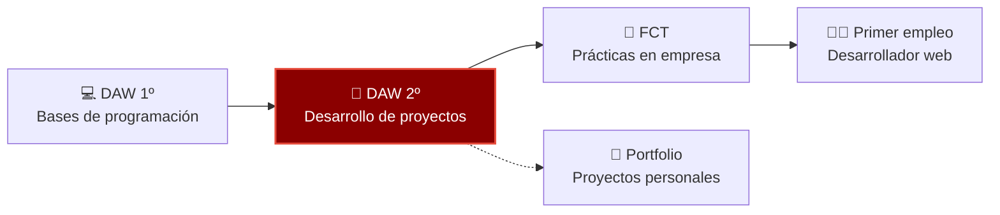

<!--
  ================================================================
  README DE PERFIL DE GITHUB · Jesús Manuel Ndong Andeme
  Estilo programador: terminal, editor de código y consola.
  ================================================================
-->

<div align="center">
  
</div>

<br>

<!-- ============ 2. ENLACES ============ -->
<p align="center">
  <a href="https://github.com/ndongandemejesusmanuel01-cyber">
    
  </a>
  <a href="https://www.linkedin.com/feed/">
    
  </a>
  <a href="mailto:TU_CORREO@gmail.com">
    
  </a>
  <a href="https://github.com/ndongandemejesusmanuel01-cyber?tab=repositories">
    
  </a>
</p>

<p align="center">
  
  
  
  
  
</p>

<p align="center"></p>

<!-- ============ 3. SOBRE MÍ ============ -->


<p align="center">
  
</p>

```js
// jesus.js

const jesus = {
  nombre: "Jesús Manuel Ndong Andeme",
  rol: "Estudiante de Desarrollo de Aplicaciones Web",
  ubicacion: "España",

  stack: [
    "HTML",
    "CSS",
    "JavaScript",
    "PHP",
    "Java",
    "MySQL"
  ],

  practicando: [
    "Java + JDBC",
    "SQL avanzado",
    "CSS Grid y Flexbox",
    "Git y GitHub"
  ],

  buscando: "Prácticas FCT y oportunidades como desarrollador web",

  motivacion: "Convertir ideas en proyectos digitales",

  lema: "Siempre aprendiendo, construyendo y mejorando.",

  saludar() {
    return "¡Hola! Encantado de conocerte 👋";
  }
};
```

<p align="center"></p>

<!-- ============ 4. TECNOLOGÍAS ============ -->


<p align="center">
  
</p>

| Área | Tecnologías |
|---|---|
| 🎨 Front-end | HTML5, CSS3, JavaScript, Grid, Flexbox y Responsive Design |
| ⚙️ Back-end | PHP, Java, JDBC y patrón DAO |
| 🗄️ Bases de datos | SQL y MySQL |
| 🧰 Herramientas | Git, GitHub, Visual Studio Code y Eclipse |

**🚀 Próximas tecnologías que quiero aprender:**

<p>
  
</p>

<p align="center"></p>

<!-- ============ 5. MI CAMINO ============ -->




```diff
+ feat: rediseño web de Carnicería Paco
+ feat: proyecto interactivo Tierra 3D
+ feat: juego Adivina el Mundial
+ feat: desarrollo web Presentation
+ feat: proyecto Sabor a Pueblo
+ feat: diseño web VaperJes
+ feat: aplicación Tienda Online con Java y MySQL
+ feat: consultas SQL y gestión de bases de datos
! wip: nuevos proyectos y aprendizaje continuo
```

<p align="center"></p>

<!-- ============ 6. PROYECTOS ============ -->


<p align="center">
  <b>🚀 MIS PROYECTOS DE DESARROLLO WEB Y PROGRAMACIÓN</b>
  <br>
  Una selección de trabajos y proyectos realizados durante mi formación.
</p>

<table>
  <tr>
    <!-- PROYECTO 1 -->
    <td align="center" width="50%">
      <a href="https://github.com/ndongandemejesusmanuel01-cyber?tab=repositories">
        
      </a>
      <br><br>
      <b>🥩 Carnicería Paco</b>
      <br>
      Rediseño de una página web para una carnicería. Incluye catálogo de productos, galería, contacto y diseño adaptable a dispositivos.
      <br><br>
      
      
    </td>

    <!-- PROYECTO 2 -->
    <td align="center" width="50%">
      <a href="https://github.com/ndongandemejesusmanuel01-cyber/Presentation">
        
      </a>
      <br><br>
      <b>💻 Presentation</b>
      <br>
      Proyecto de presentación personal y desarrollo de habilidades tecnológicas.
      <br><br>
      
      
      <br><br>
      <a href="https://github.com/ndongandemejesusmanuel01-cyber/Presentation">Ver proyecto</a>
    </td>
  </tr>

  <tr>
    <!-- PROYECTO 3 -->
    <td align="center" width="50%">
      <a href="https://ndongandemejesusmanuel01-cyber.github.io/Web_animada/">
        
      </a>
      <br><br>
      <b>🌍 Tierra 3D</b>
      <br>
      Experiencia web animada e interactiva para explorar nuestro planeta en tres dimensiones.
      <br><br>
      
      
      
      <br><br>
      <a href="https://ndongandemejesusmanuel01-cyber.github.io/Web_animada/">Ver proyecto publicado</a>
    </td>

    <!-- PROYECTO 4 -->
    <td align="center" width="50%">
      <a href="https://github.com/ndongandemejesusmanuel01-cyber?tab=repositories">
        
      </a>
      <br><br>
      <b>⚽ Adivina el Mundial</b>
      <br>
      Juego interactivo para reconocer los balones oficiales de las diferentes Copas del Mundo.
      <br><br>
      
      
      
    </td>
  </tr>

  <tr>
    <!-- PROYECTO 5 -->
    <td align="center" width="50%">
      <a href="https://github.com/ndongandemejesusmanuel01-cyber?tab=repositories">
        
      </a>
      <br><br>
      <b>🛒 Tienda Online</b>
      <br>
      Aplicación de gestión y operaciones de una tienda utilizando programación Java, conexión JDBC y base de datos MySQL.
      <br><br>
      
      
      
    </td>

    <!-- PROYECTO 6 -->
    <td align="center" width="50%">
      <a href="https://github.com/ndongandemejesusmanuel01-cyber?tab=repositories">
        
      </a>
      <br><br>
      <b>🍲 Sabor a Pueblo</b>
      <br>
      Proyecto web de un restaurante ecuatoguineano en Zaragoza, con identidad cultural, carta gastronómica y diseño visual.
      <br><br>
      
      
      
    </td>
  </tr>

  <tr>
    <!-- PROYECTO 7 -->
    <td align="center" width="50%">
      <a href="https://github.com/ndongandemejesusmanuel01-cyber?tab=repositories">
        
      </a>
      <br><br>
      <b>💨 VaperJes</b>
      <br>
      Diseño de una página web con varias secciones: inicio, servicios, galería y contacto, utilizando una hoja de estilos común.
      <br><br>
      
      
    </td>
  </tr>
</table>

<p align="center">
  <a href="https://github.com/ndongandemejesusmanuel01-cyber?tab=repositories">
    
  </a>
</p>

<p align="center"></p>

<!-- ============ 7. ESTADÍSTICAS ============ -->


<p align="center">
  
  
</p>

<p align="center">
  
</p>

<p align="center">
  
</p>

<p align="center">
  
</p>

<!-- ============ 8. SERPIENTE DE CONTRIBUCIONES (OPCIONAL) ============
Para activarla, configura primero el workflow snake.yml en .github/workflows.
Después descomenta este bloque.
-->

<!--
<p align="center">
  <picture>
    <source media="(prefers-color-scheme: dark)" srcset="https://raw.githubusercontent.com/ndongandemejesusmanuel01-cyber/ndongandemejesusmanuel01-cyber/output/github-snake-dark.svg">
    <source media="(prefers-color-scheme: light)" srcset="https://raw.githubusercontent.com/ndongandemejesusmanuel01-cyber/ndongandemejesusmanuel01-cyber/output/github-snake.svg">
    
  </picture>
</p>
-->

<p align="center"></p>

<!-- ============ 9. CONTACTO ============ -->


```js
// ¿Una idea, unas prácticas o simplemente charlar de código?
contactar("TU_CORREO@gmail.com");
```

<p align="center">
  <a href="mailto:TU_CORREO@gmail.com">
    
  </a>

  <a href="https://www.linkedin.com/feed/">
    
  </a>

  <a href="https://github.com/ndongandemejesusmanuel01-cyber">
    
  </a>
</p>

<br>

<!-- ============ 10. PIE ANIMADO ============ -->
<div align="center">
  
</div>
